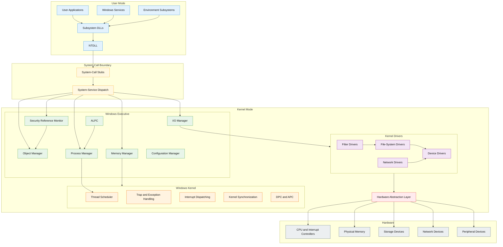

    

        
    

# **`Awesome`** Windows Internals Resources 

 

    
    &nbsp;
    
    &nbsp;
    
    

## 📖 Contents
- [Books](#books)
- [Videos](#videos)
- [My Other Awesome Lists](#my-other-awesome-lists)
- [Contributing](#contributing)
- [Contributors](#contributors)

### Books
* [Windows Internals: System architecture, processes, threads, memory management, and more, Part 1 (Developer Reference)](https://www.amazon.com/Windows-Internals-Part-architecture-management/dp/0735684189)
* [Windows Internals, Part 2 (Developer Reference)](https://www.amazon.com/Windows-Internals-Part-2-7th/dp/0135462401)
* [Windows Security Internals: A Deep Dive into Windows Authentication, Authorization, and Auditing](https://www.amazon.com/Windows-Security-Internals-Authentication-Authorization/dp/1718501986)

### Videos

##

### My Other Awesome Lists
You can access the my other awesome lists [here](https://cyberthreatdefence.com/my_awesome_lists)

### Contributing
[Contributions of any kind welcome, just follow the guidelines](contributing.md)!

### Contributors
[Thanks goes to these contributors](https://github.com/cybersecurity-dev/awesome-windows-internals-resources/graphs/contributors)!

### License

[🔼 Back to top](#awesome-windows-internals-resources-)
